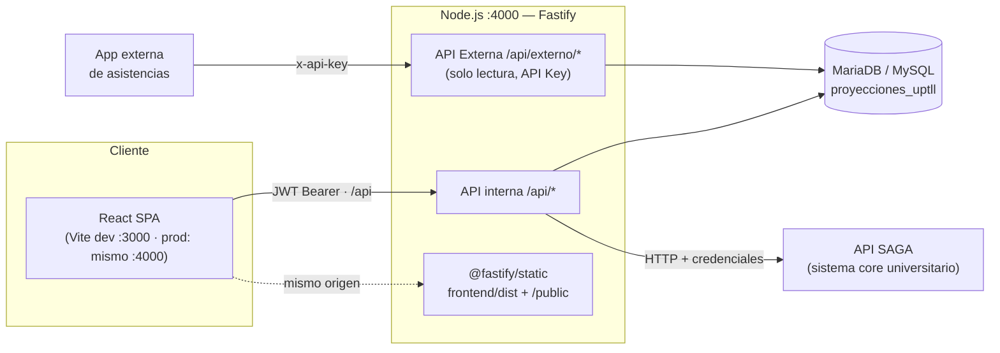
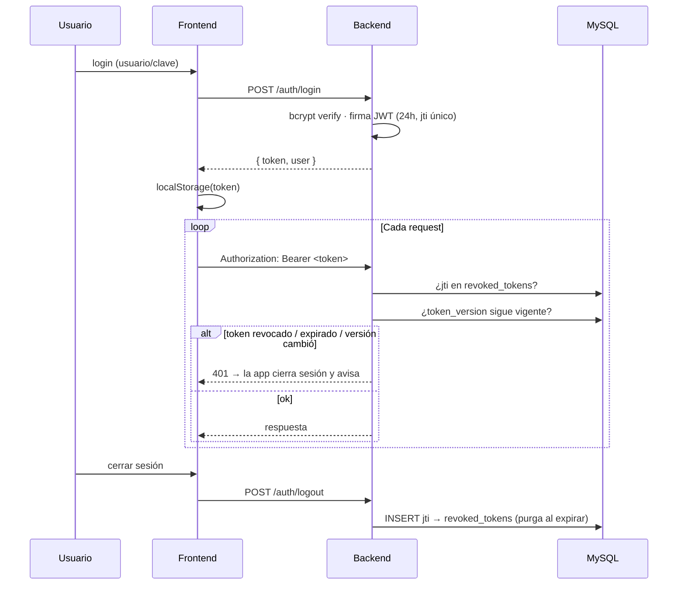
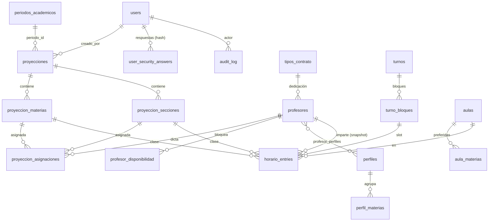
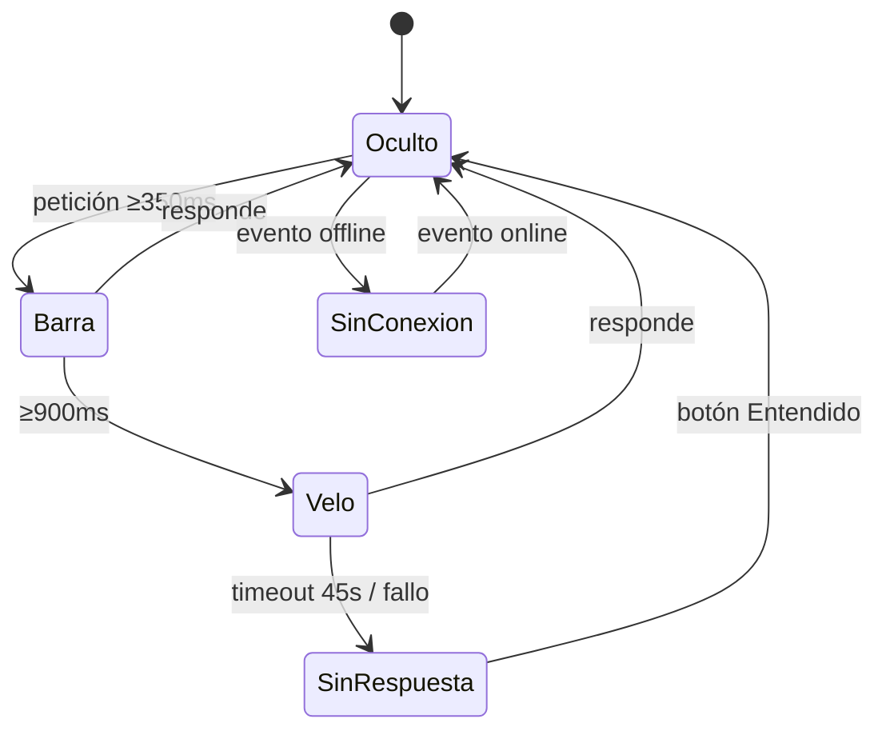
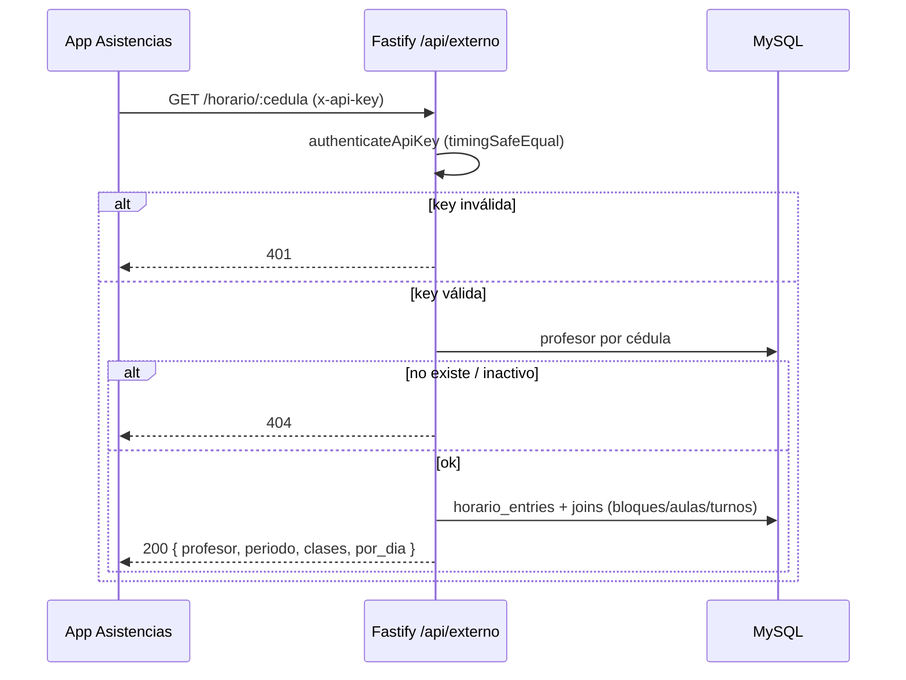
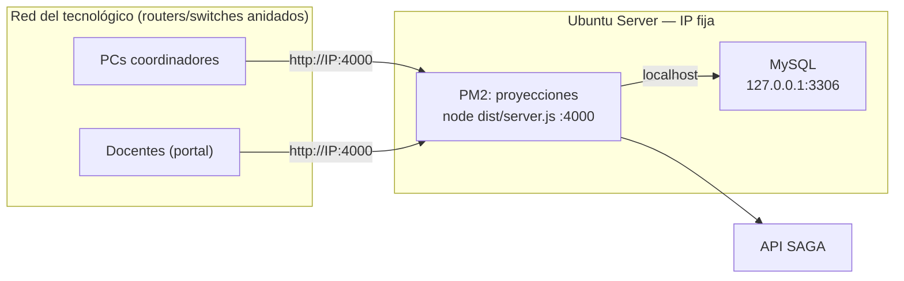

# Sistema de Proyecciones Académicas — UPTLL "Juana Ramírez"

Sistema web para la gestión de proyecciones académicas, carga docente y elaboración de horarios de la **Universidad Politécnica Territorial de los Llanos "Juana Ramírez"** (Extensión Altagracia de Orituco).

Permite crear proyecciones por PNF/trayecto, asignar profesores a unidades curriculares por sección y lapso, definir la disponibilidad docente, generar horarios automáticamente respetando conflictos de aula/sección/profesor, editar la grilla con drag & drop, llevar bitácora de cambios, exportar reportes a Excel/PDF y exponer el horario de un docente a sistemas externos (app de asistencias).

> Documentos relacionados: [`SYSTEM_SPEC.md`](SYSTEM_SPEC.md) (especificación funcional), [`REGLAS_HORARIOS.md`](REGLAS_HORARIOS.md) (reglas del módulo de horarios) y [`docs/MANUAL_USUARIO.md`](docs/MANUAL_USUARIO.md) (manual de usuario con capturas — también disponible dentro de la app: menú ⚙ → **Ayuda**).

---

## 1. Arquitectura general



- **Frontend**: SPA en React servida por Vite en desarrollo (`:3000`); en producción el **mismo backend** sirve `frontend/dist` en `:4000`, así que todo es *same-origin* (sin CORS para los usuarios).
- **Backend**: Fastify en `:4000`. Todo el API vive bajo `/api`. Archivos públicos (fotos de profesores) en `/public/`.
- **SAGA**: el backend actúa como proxy/cache hacia la API SAGA (programas, trayectos, turnos, docentes, pensum).
- **API externa**: prefijo `/api/externo`, autenticada por API key fija, **solo lectura**.

---

## 2. Stack tecnológico

| Capa | Tecnologías |
|---|---|
| Frontend | React 19, TypeScript 5.7, Vite 6, Tailwind CSS 4 (@tailwindcss/vite), lucide-react (iconos), @dnd-kit (drag & drop en grilla de horarios), exceljs (exportación Excel) |
| Backend | Node.js, Fastify 5, TypeScript, @fastify/jwt, @fastify/cors, @fastify/static, @fastify/helmet, @fastify/rate-limit, mysql2 (pool), bcryptjs (hash de contraseñas y respuestas de seguridad), tsx (dev con watch) |
| Base de datos | MariaDB / MySQL — InnoDB, utf8mb4 |
| Tests | Vitest (backend) |
| Orquestación dev | `concurrently` en el package.json raíz |

---

## 3. Requisitos

- **Node.js** ≥ 18 (recomendado 20 LTS)
- **MariaDB ≥ 10.4** o **MySQL ≥ 8** accesible (local o remoto)
- Puerto **4000** libre (API + frontend en producción) y **3000** (Vite dev)
- Credenciales de la **API SAGA** (opcional para desarrollo sin sincronización)
- Producción: Ubuntu Server + **PM2** (ver §14) — acceso por IP en la red del tecnológico

---

## 4. Variables de entorno

Archivo `backend/.env` (ver `backend/.env.example`):

| Variable | Default | Descripción |
|---|---|---|
| `PORT` | `4000` | Puerto del backend |
| `HOST` | `0.0.0.0` | Interfaz de escucha (`0.0.0.0` = accesible desde la LAN) |
| `NODE_ENV` | `development` | Entorno Node |
| `JWT_SECRET` | *(inseguro por defecto)* | Secreto para firmar JWT. **Obligatorio en producción** — si falta, el servidor no arranca (generar: `openssl rand -hex 32`) |
| `DB_HOST` / `DB_PORT` | `127.0.0.1` / `3306` | Host/puerto de MariaDB/MySQL (mantener `127.0.0.1` si la BD está en el mismo servidor — no exponerla a la red) |
| `DB_USER` / `DB_PASSWORD` | `root` / `''` | Credenciales de BD |
| `DB_NAME` | `proyecciones_uptll` | Nombre de la base de datos (se crea sola si no existe) |
| `API_URL` | `http://127.0.0.1:8000/api/v1` | URL base de la API SAGA |
| `API_USER` / `API_PASSWORD` | — | Credenciales SAGA |
| `EXTERNAL_API_KEY` | *(vacío = deshabilitado)* | Clave fija para `/api/externo`. Sin ella el endpoint responde 503. Generar una cadena larga y aleatoria |
| `CORS_ORIGINS` | dev: `localhost:3000` · prod: *vacío* | Orígenes extra permitidos (CSV). En producción no hace falta: el frontend es same-origin |
| `SERVE_FRONTEND` | `1` | `0` desactiva que el backend sirva `frontend/dist` (útil en dev para no confundir builds viejos) |

El frontend **no necesita `.env`**: en dev el proxy de Vite redirige `/api` y `/public` → `127.0.0.1:4000` (este último sirve las fotos de profesores del backend). El manual de usuario es estático del propio frontend (`frontend/public/manual`, accesible en `/manual/index.html`).

---

## 5. Instalación y ejecución

```bash
# 1. Instalar dependencias (raíz, backend y frontend)
npm install
npm --prefix backend install
npm --prefix frontend install

# 2. Configurar backend/.env (copiar .env.example y ajustar)
cp backend/.env.example backend/.env

# 3. Levantar todo en desarrollo (backend :4000 + frontend :3000)
npm run dev
```

Scripts disponibles:

| Comando | Acción |
|---|---|
| `npm run dev` | Backend (tsx watch) + frontend (vite) en paralelo |
| `npm run dev:backend` | Solo backend, recarga en caliente |
| `npm run dev:frontend` | Solo frontend |
| `npm run build` | Compila backend (`tsc` → `dist/`) y frontend (`tsc && vite build`) |
| `npm run start:backend` | Producción: `node dist/server.js` |
| `npm --prefix backend test` | Suite de tests unitarios (Vitest) |
| `npm --prefix backend run db:init` | Ejecuta migraciones/seed sin levantar el servidor |

**Inicialización automática**: al arrancar, `server.ts` ejecuta `initializeDatabase()` que crea la BD, las **24 tablas**, índices, periodo inicial y el usuario `admin`/`admin123` (`SUPER_USUARIO`) si no existen. Las migraciones son idempotentes (`CREATE TABLE IF NOT EXISTS` + `ALTER` verificados vía `information_schema`). Además, en cada arranque se garantiza que exista **al menos un Master activo**: si ninguno existe se crea/restaura `admin` (username reservado del sistema).

**Verificar que todo corre**:

```bash
curl.exe http://localhost:4000/api/health
# {"status":"OK","system":"Proyecciones Académicas UPTLL Juana Ramírez","db":"up","timestamp":"..."}
```

Frontend: http://localhost:3000 — login con `admin / admin123`.

---

## 6. Estructura del proyecto

```
ProyeccionesRebuild/
├── package.json                  # scripts raíz (concurrently)
├── backend/
│   ├── .env / .env.example
│   └── src/
│       ├── server.ts             # bootstrap + initializeDatabase() + chequeos de reloj
│       ├── app.ts                # buildApp(): helmet, CORS, rate-limit, /api/health,
│       │                         #  static (dist + /public), fallback SPA
│       ├── config/env.ts         # variables de entorno + validaciones de producción
│       ├── db/mysql.ts           # pool mysql2 (connectTimeout) + helper query()
│       ├── db/init.ts            # schema 24 tablas + migraciones idempotentes + seed
│       ├── plugins/
│       │   ├── authGuard.ts      # authenticate (JWT + revocación) + authorizeRoles
│       │   └── apiKeyGuard.ts    # authenticateApiKey (x-api-key / Bearer)
│       ├── modules/
│       │   ├── auth/             # login, profesor-login, me, logout (revoca),
│       │   │                     #  preguntas de seguridad y recuperación
│       │   ├── saga/             # proxy a la API SAGA
│       │   ├── proyecciones/     # proyecciones + carga docente + asignaciones
│       │   │                     #  + copiar-periodo (rollover)
│       │   ├── periodos/         # periodos académicos
│       │   ├── profesores/       # CRUD, foto, perfiles, disponibilidad (simple y bulk),
│       │   │                     #  tipos de contrato
│       │   ├── perfiles/         # perfiles docentes
│       │   ├── usuarios/         # gestión de usuarios (MASTER) + auto-edición /me
│       │   ├── horarios/         # aulas, turnos, bloques, entries, generador
│       │   ├── reportes/         # plantillas de encabezado + resumen para dashboard
│       │   ├── auditoria/        # bitácora de cambios (lectura filtrada por rol/PNF)
│       │   ├── buscar/           # búsqueda global (Ctrl+K)
│       │   └── externo/          # API de solo lectura (API key) para asistencias
│       └── utils/
│           ├── security.ts       # hashPassword / verifyPassword (bcryptjs)
│           ├── errorLog.ts       # stream pino→stdout + errores a logs/YYYY-MM-DD.log
│           └── texto.ts          # normTxt / normalizarRespuesta
└── frontend/
    └── src/
        ├── api/client.ts         # apiFetch() + estado global de red (pendientes,
        │                         #  etiqueta, timeout 45s, online/offline)
        ├── context/              # AuthContext, PnfColorContext
        ├── pages/
        │   ├── IndicadorRed.tsx  # barra/velo "esperando servidor" + banner sin respuesta
        │   └── horarios/         # editor: grilla drag&drop, peeks ⇧/Ctrl, undo
        └── utils/                # plantillas.ts, logo.ts, print.ts
```

**Convención**: imports TypeScript con extensión `.js` (`import ... from './x.js'`) por ESM.

---

## 7. Autenticación, sesiones y roles

### JWT de usuarios (`/api/auth`)

| Endpoint | Acceso | Descripción |
|---|---|---|
| `POST /api/auth/login` | Público · 10/min | `{username, password}` → `{token, user}`. Token 24h |
| `POST /api/auth/profesor-login` | Público · 10/min | `{cedula}` → token de invitado 12h (`role: PROFESOR`, `invitado: true`, `id = -profesor.id`) |
| `GET /api/auth/security-questions` | Público | Catálogo de preguntas de seguridad |
| `GET /api/auth/recovery-questions?username=` | Público · 10/min | Preguntas configuradas por un usuario — respuesta uniforme (anti-enumeración) |
| `POST /api/auth/recover-password` | Público · 10/min | `{username, respuestas[], nueva}` → reset por preguntas |
| `GET /api/auth/me` | JWT | Datos del usuario autenticado |
| `POST /api/auth/logout` | JWT | **Revoca el token en servidor** (su `jti` pasa a `revoked_tokens`) |

El frontend envía `Authorization: Bearer <token>` en cada request (ver `apiFetch` en `frontend/src/api/client.ts`).

### Ciclo de vida de la sesión



- **Revocación**: cada token lleva `jti`; logout lo inserta en `revoked_tokens` y `authenticate` lo rechaza en adelante. `users.token_version` invalida **todos** los tokens previos de un usuario (al cambiar la contraseña).
- **Tolerancia de reloj**: la verificación admite ±1 h de desfase (`clockTolerance`) — pensado para servidores que pierden la hora tras cortes eléctricos. Un reloj *atrasado* no rompe sesiones; un salto grande adelante solo obliga a re-loguearse.
- Al arrancar, `server.ts` avisa en el log si la fecha del sistema es implausible o si el reloj de MySQL difiere del del proceso.

### Roles

| Rol | Etiqueta UI | Alcance |
|---|---|---|
| `SUPER_USUARIO` | Master | Acceso total sin restricciones + gestión de usuarios + auditoría completa |
| `ADMINISTRADOR` | Coordinador | Ve todo e imprime todo; escribe **solo en su PNF**; auditoría **solo de su PNF**. Requiere `pnf_saga_id` obligatorio — sin él, toda escritura acotada a PNF → 403 |
| `REGULAR` | Usuario | **Solo lectura** en todo el sistema |
| `PROFESOR` | Docente | Portal propio: solo lectura + editar **su propia** disponibilidad (`PUT /profesores/:id/disponibilidad` y `/disponibilidad-bulk` — el handler verifica que el id sea el suyo) |

Reglas específicas del **Coordinador** (`ADMINISTRADOR`), aplicadas en cada handler:

- **Periodos**: solo lectura — crear/editar/eliminar es exclusivo de Master.
- **Proyecciones**: crear/editar/activar/borrar/copiar-periodo solo con `pnf_saga_id` igual al suyo.
- **Horarios**: muta entries/genera/resuelve aulas solo de su PNF; la lectura de la grilla no se filtra.
- **Carga docente**: asigna solo materias de su PNF **a cualquier profesor**; puede *quitar* una materia de otro PNF únicamente cuando el profesor asignado es de su PNF.
- **Profesores**: crea/edita solo docentes de su PNF (los ve todos).
- **Auditoría**: ve solo registros con `pnf_saga_id` igual al suyo (filtro forzado en servidor).
- **Catálogos globales** (aulas, turnos, tipos de contrato, perfiles docentes): editable por Master + Coordinador.
- **Color de PNF**: Master todos; Coordinador solo el suyo.
- **Reportes**: imprime cualquier reporte sin restricción; puede editar plantillas de encabezado.

Guards (`backend/src/plugins/authGuard.ts`): `authenticate` verifica el JWT (firma + `jti` revocado + `token_version`, con tolerancia de reloj); `authorizeRoles(...)` filtra por rol (ambos como `preHandler` por ruta); `esCoordinadorDeOtroPnf(user, pnf)` centraliza en los handlers la validación "Coordinador vs PNF ajeno" (true también cuando no tiene PNF).

---

## 8. Seguridad

- **Rate limiting** (`@fastify/rate-limit`): global permisivo de **6000 req/min por IP** (el editor de horarios encadena mutación + recargas; el techo solo frena bucles descontrolados). Estricto de **10 req/min** en login, profesor-login y recuperación de contraseña (anti fuerza bruta).
- **Helmet**: cabeceras de seguridad (`contentSecurityPolicy` desactivado: la SPA carga recursos propios).
- **CORS**: same-origin siempre permitido; orígenes extra solo vía `CORS_ORIGINS`.
- **Revocación de tokens**: `revoked_tokens` (jti) + `users.token_version` (invalida sesiones al cambiar clave).
- **Recuperación anti-enumeración**: `/recovery-questions` y `/recover-password` responden igual exista o no el usuario; respuestas de seguridad guardadas como **hash bcrypt** de la respuesta normalizada (nunca texto plano); contraseña mínima 8 caracteres.
- **API externa**: API key comparada con `crypto.timingSafeEqual`.
- **SQL parametrizado** en todos los handlers; `JWT_SECRET` obligatorio en producción (el servidor no arranca sin él).
- **Restauración de Master**: `admin` es username reservado; si no queda ningún Master activo al arrancar, se recrea — evita bloquearse el acceso.

---

## 9. Patrones de diseño

- **Modular monolith**: cada dominio es un módulo `modules/<x>/` con `routes.ts` (declaración + guards), `controller.ts` (handlers) y `service.ts` opcional (lógica pesada, ej. `scheduler.service.ts`).
- **Middleware/guards**: `preHandler` de Fastify para auth y autorización por ruta.
- **Repository simple**: helper `query<T>(sql, params)` sobre pool `mysql2/promise`; SQL parametrizado en todos los handlers. El pool usa `connectTimeout: 10s` para no colgar requests si MySQL es inalcanzable.
- **Respuesta uniforme**: `{ success: boolean, message?: string, data?: any }`.
- **Migraciones auto-ejecutables**: `init.ts` en el arranque — sin herramienta externa de migraciones.
- **Auditoría**: helper `audit()` registra acción/entidad/usuario/PNF en `audit_log` desde los handlers de mutación.
- **Logger de errores persistente** (`utils/errorLog.ts`): el stream de pino duplica a stdout (PM2 lo captura igual) y los logs de nivel error/fatal se agregan a `backend/logs/YYYY-MM-DD.log` — un archivo de texto por día, ordenable por nombre, con método/ruta/reqId/mensaje/stack. Captura todos los `request.log.error` de los controllers sin tocarlos, más `unhandledRejection`/`uncaughtException`. Al arrancar se borran los `.log` de más de 30 días; un fallo de escritura nunca tumba la app.
- **Estado de red global (frontend)**: `client.ts` mantiene contador de peticiones + etiqueta + `enLinea`; `apiFetch` acepta `etiqueta` (texto contextual) y `silencioso` (fetchs de fondo que no disparan indicador). `IndicadorRed` se suscribe y renderiza el feedback (ver §12).
- **Frontend**: Context API (`AuthContext`, `PnfColorContext`), componentes de página + modales, guardado con debounce (plantillas de reporte ~800 ms), exportación cliente con exceljs + impresión HTML en iframe oculto.
- **Snapshot denormalizado**: `horario_entries.profesor_id` se sincroniza al cambiar la asignación (los horarios no se rompen al reasignar).

---

## 10. Esquema de base de datos

**24 tablas** (todas InnoDB, utf8mb4). Diagrama de relaciones principales:



### Catálogo de tablas

| Tabla | Propósito | Columnas clave |
|---|---|---|
| `users` | Usuarios del sistema | `username` UK, `password` (bcrypt), `role` ENUM, `pnf_saga_id`, `profesor_cedula`, `token_version`, `activo` |
| `pnf` | Programas Nacionales de Formación | `saga_id` UK, `nombre`, `codigo`, `color`, `tipo` (TRIMESTRAL/SEMESTRAL) |
| `trayectos` | Niveles académicos | `saga_id` UK, `nombre`, `orden` |
| `turnos` | Turnos de clase | `saga_id` UK NULL (local), `nombre`, `dias_semana` CSV 1–7, `horas_jornada`, `activo` |
| `turno_bloques` | Bloques horarios por turno | `turno_id` FK, `orden`, `hora_inicio`, `hora_fin`, `es_receso` — UK `(turno_id, orden)` |
| `periodos_academicos` | Periodos | `codigo` UK (`2026-1`), `nombre`, `fecha_inicio/fin`, `estado` (PLANIFICACION/ACTIVO/CERRADO) |
| `proyecciones` | Proyección PNF×trayecto×periodo | `codigo` UK, `periodo_id` FK, `pnf_saga_id`, `trayecto_saga_id`, `maya_id`, `periodo_academico`, `tipo_proyeccion`, `activa`, `creado_por` FK |
| `proyeccion_materias` | UCs de la proyección | `proyeccion_id` FK, `seccion_id` NULL = todas, `subject_saga_id`, `horas_semanales`, flags `q1..q3`, `semestre1/2`, `eliminada` |
| `proyeccion_secciones` | Secciones de la proyección | `proyeccion_id` FK, `nombre`, `turno_saga_id`, `turno_nombre`, `estudiantes_estimados`, `maya_id`, `congelada` |
| `aulas` | Aulas/laboratorios | `codigo` UK, `capacidad`, `tipo` ENUM (AULA_REGULAR…INSTALACION_DEPORTIVA), `pnf_saga_id`/`pnf_nombre` = PNF preferido |
| `aula_materias` | Materias preferidas por aula | PK `(aula_id, materia_nombre)` — por nombre normalizado |
| `tipos_contrato` | Dedicación docente | `saga_id` UK NULL, `nombre`, `horas_semanales` |
| `profesores` | Docentes | `cedula` UK, `saga_id`, `nombres/apellidos`, `pnf_saga_id`, `tipo_contrato_id` FK, `foto_url`, `origen` (SAGA/LOCAL), `activo` |
| `proyeccion_asignaciones` | Profesor por materia×sección×lapso | UK `(materia_id, seccion_id, trimestre)`; ausencia = sin asignar |
| `perfiles` | Perfiles docentes (afinidad) | `nombre` UK |
| `perfil_materias` | Materias de cada perfil | UK `(perfil_id, subject_saga_id)` |
| `profesor_perfiles` | Perfiles de cada profesor | PK `(profesor_id, perfil_id)` |
| `profesor_disponibilidad` | Slots **bloqueados** del docente | UK `(profesor_id, dia_semana, hora_inicio, hora_fin)` — ausencia = disponible |
| `horario_entries` | Una clase agendada | UK `(periodo, tipo, trimestre, dia, bloque, seccion)`; `profesor_id` snapshot; FKs a materia/sección/bloque/aula |
| `horario_config` | Reglas del generador (fila única id=1) | `min_horas_bloque`, `max_horas_dia`, `formato_12h` |
| `reportes_plantillas` | Encabezados editables de reportes | PK `reporte` (`horarios_seccion`, `horarios_aulas`, `horarios_profesores`, `carga_docente`), `encabezado` JSON |
| `user_security_answers` | Respuestas de seguridad para recuperación | PK `(user_id, pregunta_idx)`, `respuesta_hash` (bcrypt de la respuesta normalizada) |
| `revoked_tokens` | JWT invalidados (logout/cambio de clave) | PK `jti`, `expires_at` (las filas se purgan al expirar naturalmente) |
| `audit_log` | Bitácora de cambios | `user_id`, `username`, `role`, `accion`, `entidad`, `entidad_id`, `detalle` JSON, `pnf_saga_id`, `created_at` — índices por fecha/entidad/PNF |

> Reglas de conflicto/solape del horario (aula/sección/profesor por tiempo real, lapsos rivales, recesos, días hábiles del turno): ver [`REGLAS_HORARIOS.md`](REGLAS_HORARIOS.md).

---

## 11. API REST — catálogo de endpoints

Convención de auth: **JWT** = `Authorization: Bearer`; 🔒roles = `authorizeRoles` indicado.

### `/api/health` y estáticos

| Método | Ruta | Auth | Descripción |
|---|---|---|---|
| GET | `/api/health` | Público | `{status, db: up/down, timestamp}` — 503 si la BD cae |
| GET | `/public/*` | Público | Archivos estáticos (fotos de profesores) |

### `/api/auth`

| Método | Ruta | Auth | Descripción |
|---|---|---|---|
| POST | `/login` | Público · 10/min | Login usuario → `{token, user}` |
| POST | `/profesor-login` | Público · 10/min | Login docente por cédula → token invitado |
| GET | `/security-questions` | Público | Catálogo de preguntas de seguridad |
| GET | `/recovery-questions` | Público · 10/min | Preguntas de un usuario (respuesta uniforme) |
| POST | `/recover-password` | Público · 10/min | Reset de contraseña por respuestas |
| GET | `/me` | JWT | Perfil de la sesión |
| POST | `/logout` | JWT | Revoca el token actual (jti → `revoked_tokens`) |

### `/api/saga` — proxy a la API SAGA (todos JWT)

| Método | Ruta | Descripción |
|---|---|---|
| GET | `/status` | Estado de conexión con SAGA (503 si cae) |
| GET | `/programas` | PNFs desde SAGA |
| GET | `/trayectos` | Trayectos |
| GET | `/turnos` | Turnos |
| GET | `/teachers` | Docentes |
| GET | `/mayas/:pnfSagaId` | Pensum/mallas del PNF |
| GET | `/materias-maya/:pnfSagaId/:mayaId` | UCs de una malla |
| GET | `/ucslist/:pnfSagaId/:trayectoSagaId/:mayaId` | UCs por trayecto |
| GET | `/inscriptions-summary/:pnfSagaId/:trayectoSagaId` | Resumen de inscripciones |

### `/api/proyecciones`

| Método | Ruta | Auth | Descripción |
|---|---|---|---|
| GET | `/carga-docente` | JWT | Matriz profesor×materia×sección×lapso del periodo |
| PUT | `/asignaciones` | ESCRITORES + regla PNF | Asignar/quitar profesor. Coord: solo asigna materias de su PNF (a cualquier docente); quita materias ajenas solo si el docente es suyo |
| POST | `/copiar-periodo` | ESCRITORES + PNF | Rollover de periodo: copia proyecciones/secciones/asignaciones a otro periodo (omite existentes) |
| POST | `/` | ESCRITORES + PNF | Crear proyección (Coord: solo de su PNF) |
| GET | `/`, `/:id` | JWT | Listar / detalle |
| PUT / DELETE | `/:id` | ESCRITORES + PNF | Editar / eliminar (Coord: solo su PNF) |
| PUT | `/:id/toggle-active` | ESCRITORES + PNF | Activar/desactivar (Coord: solo su PNF) |

### `/api/periodos`

| Método | Ruta | Auth | Descripción |
|---|---|---|---|
| GET | `/`, `/activos` | JWT | Listar todos / solo activos |
| POST | `/` | MASTER | Crear periodo |
| PUT / DELETE | `/:id` | MASTER | Editar / eliminar |

### `/api/profesores`

| Método | Ruta | Auth | Descripción |
|---|---|---|---|
| GET | `/`, `/:id` | JWT | Listar (`?para_asignacion=1&incluir_inactivos=1`) / detalle |
| POST | `/` | ESCRITORES + PNF | Crear profesor local (Coord: solo de su PNF) |
| PUT | `/:id` | ESCRITORES + PNF | Editar (Coord: solo su PNF) |
| PUT | `/:id/toggle-activo` | ESCRITORES + PNF | Activar/desactivar |
| PUT / DELETE | `/:id/foto` | ESCRITORES + PNF | Subir (base64, ≤3 MB) / borrar foto |
| POST | `/sync` | ESCRITORES | Sincronizar docentes desde SAGA |
| GET | `/:id/perfiles`, `/:id/perfiles-materias` | JWT | Perfiles del docente y sus materias afines |
| PUT | `/:id/perfiles` | ESCRITORES + PNF | Reemplazar perfiles (Coord: solo su PNF) |
| GET | `/:id/disponibilidad` | JWT | Slots bloqueados (PROFESOR: solo la propia) |
| PUT | `/:id/disponibilidad` | ESCRITORES + PROFESOR*(solo la propia)* | Marcar/desmarcar slot bloqueado (Coord: solo profesores de su PNF) |
| PUT | `/:id/disponibilidad-bulk` | ESCRITORES + PROFESOR*(solo la propia)* | Edición en bloque: marcar/desmarcar varios slots de una vez (día/fila completa) |
| GET/POST/PUT/DELETE | `/tipos-contrato…` | GET: JWT · resto: ESCRITORES | CRUD de dedicaciones |
| POST | `/tipos-contrato/sync` | ESCRITORES | Sincronizar dedicaciones desde SAGA |

### `/api/perfiles`

| Método | Ruta | Auth | Descripción |
|---|---|---|---|
| GET | `/materias-catalogo` | JWT | Catálogo de materias para armar perfiles |
| GET | `/` | JWT | Listar perfiles |
| POST / PUT / DELETE | `/`, `/:id` | ESCRITORES | CRUD de perfiles |

### `/api/usuarios`

| Método | Ruta | Auth | Descripción |
|---|---|---|---|
| PUT | `/me` | JWT | **Auto-edición** de la propia cuenta (username, contraseña — eleva `token_version` e invalida otras sesiones) |
| GET | `/me/security-questions` | JWT | Preguntas configuradas por el usuario actual |
| GET | `/` | MASTER | Listar usuarios |
| POST | `/` | MASTER | Crear usuario (cualquier rol; Coordinador exige `pnf_saga_id`; `admin` reservado) |
| PUT | `/:id` | MASTER | Editar usuario |
| PUT | `/:id/toggle-activo` | MASTER | Activar/desactivar |

### `/api/horarios`

| Método | Ruta | Auth | Descripción |
|---|---|---|---|
| GET | `/aulas`, `/materias`, `/pnfs`, `/turnos`, `/config`, `/entries` | JWT | Catálogos y entries del lapso (`?periodo=&tipo=&trimestre=`) |
| POST/PUT/DELETE | `/aulas…` | ESCRITORES | CRUD de aulas (catálogo global) |
| PUT | `/pnfs/:sagaId/color` | ESCRITORES + PNF | Color del PNF en la UI (Coord: solo el suyo) |
| POST / DELETE | `/turnos`, `/turnos/:id` | ESCRITORES | Crear/eliminar turno |
| PUT | `/turnos/:id`, `/turnos/:id/bloques` | ESCRITORES | Editar turno / redefinir bloques |
| DELETE | `/turnos/:id/entries` | ESCRITORES + PNF | Borrar entries del turno (Coord: solo su PNF) |
| PUT | `/config` | ESCRITORES | Reglas del generador (`horario_config`) |
| PUT | `/entries` | ESCRITORES + PNF | Upsert de una clase — valida conflictos por tiempo real (Coord: solo su PNF) |
| POST | `/entries/swap`, `/move-group`, `/schedule-group`, `/unschedule`, `/aula-grupo`, `/resolver-aulas` | ESCRITORES + PNF | Operaciones de la grilla (Coord: solo su PNF) |
| DELETE | `/entries/:id` | ESCRITORES + PNF | Borrar una clase (Coord: solo su PNF) |
| POST | `/generar` | ESCRITORES + PNF | Generación automática del lapso (Coord: scopeada a su PNF) |

### `/api/reportes`

| Método | Ruta | Auth | Descripción |
|---|---|---|---|
| GET | `/resumen` | JWT | Métricas del periodo para las tarjetas del dashboard |
| GET | `/plantilla/:reporte` | JWT | Plantilla guardada (`horarios_seccion`, `horarios_aulas`, `horarios_profesores`, `carga_docente`) |
| PUT | `/plantilla/:reporte` | ESCRITORES | Guardar plantilla (PROFESOR/REGULAR → 403) |

### `/api/auditoria` — bitácora de cambios

| Método | Ruta | Auth | Descripción |
|---|---|---|---|
| GET | `/` | MASTER + COORDINADOR | Registros de `audit_log`. Master los ve todos; Coordinador **solo los de su PNF** (filtro forzado en servidor). Query: `?entidad=&accion=&pnf_saga_id=&username=&desde=&hasta=&limite=≤500&offset=` |

### `/api/buscar` — búsqueda global

| Método | Ruta | Auth | Descripción |
|---|---|---|---|
| GET | `/?q=` | JWT | Busca en secciones, materias, profesores, aulas y periodos — usada por la paleta Ctrl+K del frontend |

### `/api/externo` — integraciones (API key, solo lectura)

| Método | Ruta | Auth | Descripción |
|---|---|---|---|
| GET | `/horario/:cedula` | `x-api-key` | Horario del docente para la app de asistencias |

> Solo se registran métodos GET: no existe forma de escribir por este prefijo.

**Grupos de roles**: `ESCRITORES` = SUPER_USUARIO + ADMINISTRADOR (Coordinador) · `MASTER` = solo SUPER_USUARIO · `+ PNF` = el Coordinador además debe ser dueño del recurso (`esCoordinadorDeOtroPnf`). `REGULAR` (Usuario) y `PROFESOR` reciben 403 en toda escritura — salvo la disponibilidad propia del docente.

---

## 12. UX del frontend

### Indicador global de red (`IndicadorRed`)

`apiFetch` lleva un **contador de peticiones** con etiqueta contextual; el componente global muestra:

| Situación | Feedback |
|---|---|
| Petición < 350 ms | Nada (sin parpadeo) |
| ≥ 350 ms | Barra indeterminada en el borde superior |
| ≥ 900 ms | Velo bloqueante "Esperando respuesta del servidor…" + etiqueta (ej. "Cambiando el aula…") |
| Sin respuesta a los **45 s** (timeout `AbortController`) o fallo de red | Banner grande **"El servidor no responde"** con botón *Entendido* |
| `navigator.offline` | Banner **"Sin conexión a la red"** que se retira solo al volver |

Las llamadas con `silencioso: true` (prefetch del catálogo de materias, búsqueda por tecla) no disparan el indicador. El contador siempre se decrementa en `finally` — el velo no puede quedarse colgado.



### Editor de horarios (grilla)

- **Drag & drop**: clase ↔ celda (mover), clase ↔ clase (intercambio), bloque de varias horas como grupo, chip pendiente → celda, clase → panel pendientes (desagendar). Celdas destino se pintan válida/inválida en vivo.
- **⇧ Shift + hover** sobre una materia: ilumina en ámbar los bloques que su profesor ya tiene ocupados (en cualquier sección; compara por rango horario, respeta traslapes de lapsos). Funciona también durante un arrastre.
- **Ctrl + hover** sobre cualquier bloque (incluso bajo una clase): tooltip con las **aulas libres** ahí — máx. 5, las del PNF de la sección primero, `+N más…`.
- **Ctrl+Z**: deshacer (stack de snapshots por sección).
- **Ctrl+K**: búsqueda global (paleta de comandos).
- **Punto rojo / triángulo amarillo / icono verde** en tarjetas: conflicto de auditoría, advertencias de reglas y choques parciales T2↔semestre, con tooltip explicativo.
- Menú contextual de clase: cambiar aula (con disponibilidad en vivo), quitar del horario.
- Modal "Aulas libres ahora" + heatmap de ocupación por aula.

---

## 13. API externa de asistencias

Endpoint de **solo lectura** para que la app de asistencias consulte el horario de un docente.

### Autenticación

1. Definir en `backend/.env`:
   ```
   EXTERNAL_API_KEY=cadena_larga_aleatoria
   ```
2. Enviar la clave en cada request, por header:
   ```
   x-api-key: <clave>
   ```
   o alternativamente `Authorization: Bearer <clave>`.

La comparación usa `crypto.timingSafeEqual`. Sin clave configurada → **503**; clave ausente/inválida → **401**.

### Endpoint

```
GET /api/externo/horario/:cedula?periodo=&tipo=&trimestre=
```

| Param | Ubicación | Descripción |
|---|---|---|
| `cedula` | path (req.) | Cédula del docente |
| `periodo` | query | Código del periodo (`2026-1`); default: el ACTIVO |
| `tipo` | query | `TRIMESTRAL` o `SEMESTRAL` |
| `trimestre` | query | Nº de lapso (1–3 / 1–2) |

> Sin filtros devuelve **todos los lapsos** del periodo — la app debería filtrar por el lapso vigente, ej. `?tipo=TRIMESTRAL&trimestre=2`.

### Respuesta

```json
{
  "success": true,
  "data": {
    "profesor": { "id": 65, "cedula": "12118656", "nombres": "JOSE RAFAEL",
                  "apellidos": "ALMEA FUENTES", "pnf_nombre": "P.N.F. en Administración" },
    "periodo": "2026-1",
    "clases": [
      { "dia_semana": 1, "dia": "Lunes", "hora_inicio": "07:00", "hora_fin": "07:45",
        "materia": "PROYECTO SOCIO INTEGRADOR III", "materia_id": 146,
        "seccion": "M-01", "seccion_id": 26,
        "aula": "A6", "aula_nombre": "Aula 6", "turno": "Mañana",
        "tipo_proyeccion": "TRIMESTRAL", "trimestre": 1 }
    ],
    "por_dia": { "lunes": [ /* mismas clases agrupadas */ ], "martes": [] }
  }
}
```

`clases` viene ordenada por día + hora; `por_dia` agrupa las mismas entradas con claves en minúscula (`lunes`…`domingo`).

### Errores

| HTTP | Caso |
|---|---|
| 400 | Falta la cédula |
| 401 | API key ausente o inválida |
| 404 | Docente inexistente/inactivo, o sin periodo activo |
| 503 | `EXTERNAL_API_KEY` no configurada |

### Prueba rápida (PowerShell usa `curl.exe`)

```powershell
curl.exe "http://localhost:4000/api/externo/horario/12118656" -H "x-api-key: UPTLL_Altagracia_31416"
curl.exe "http://localhost:4000/api/externo/horario/12118656?tipo=TRIMESTRAL&trimestre=2" -H "x-api-key: UPTLL_Altagracia_31416"
```

### Flujo (diagrama de secuencia)



---

## 14. Despliegue en producción — Ubuntu Server + PM2

Topología objetivo: el backend sirve la SPA compilada, así que los usuarios acceden a `http://<IP-del-servidor>:4000` — todo **same-origin**, sin CORS ni dominio.



### `.env` de producción

```env
NODE_ENV=production
PORT=4000
HOST=0.0.0.0
JWT_SECRET=<openssl rand -hex 32>
DB_HOST=127.0.0.1
DB_PORT=3306
DB_USER=proyecciones
DB_PASSWORD=<clave real>
DB_NAME=proyecciones_uptll
API_URL=<URL de SAGA>
API_USER=<usuario saga>
API_PASSWORD=<clave saga>
EXTERNAL_API_KEY=<cadena larga aleatoria>
CORS_ORIGINS=          # vacío: todo es same-origin
```

### Pasos

```bash
# 1. Build
cd frontend && npm ci && npm run build
cd ../backend && npm ci && npm run build

# 2. Firewall: solo el 4000 (MySQL se queda en localhost)
sudo ufw allow 4000/tcp

# 3. PM2 con cwd al backend (dotenv busca .env relativo a cwd)
cat > ecosystem.config.js <<'EOF'
module.exports = {
  apps: [{
    name: 'proyecciones',
    script: 'dist/server.js',
    cwd: './backend',
    env: { NODE_ENV: 'production' },
  }],
};
EOF
pm2 start ecosystem.config.js
pm2 save
pm2 startup systemd   # ejecuta el comando que imprime
```

### Checklist de red/reloj

- **IP fija** del servidor (netplan o reserva DHCP por MAC) — si cambia, todos pierden acceso.
- Verificar desde cada subred: `curl http://<IP>:4000/api/health` → 200. Si falla es enrutamiento/firewall, no la app.
- Routers anidados: vigilar *client isolation* en APs WiFi; si un segmento hace NAT, todas sus PCs comparten el contador de rate-limit (6000/min sigue sobrado).
- **MySQL**: `bind-address = 127.0.0.1` — nunca abrir el 3306.
- **Reloj**: si el servidor pierde la hora tras cortes eléctricos, instalar `fake-hwclock` y activar `systemd-timesyncd` (NTP puede apuntar a un router u host interno). Los JWT toleran ±1 h; en el peor caso los usuarios solo vuelven a loguearse.

---

## 15. Verificación y pruebas

| Verificación | Comando |
|---|---|
| Tests unitarios (Vitest, ~35 casos) | `npm --prefix backend test` |
| Typecheck backend | `npm --prefix backend run build` (o `cd backend && npx tsc --noEmit`) |
| Typecheck + build frontend | `npm --prefix frontend run build` |
| Health (incluye ping a BD) | `curl.exe http://localhost:4000/api/health` |
| Login smoke test | `curl.exe -X POST http://localhost:4000/api/auth/login -H "Content-Type: application/json" -d '{"username":"admin","password":"admin123"}'` |
| Externo sin key (espera 401) | `curl.exe http://localhost:4000/api/externo/horario/12118656` |

La suite cubre la lógica más delicada: semántica de conflictos del generador (`lapsosTotales`/`lapsosParciales`, `seTraslapan`, `conflictoEn`, `aulasOcupadas`, `elegirAula`) y utilidades de texto/preguntas de seguridad (`normTxt`, `normalizarRespuesta`, catálogo `PREGUNTAS_SEGURIDAD`).

---

## 16. Troubleshooting

| Síntoma | Causa probable | Solución |
|---|---|---|
| ¿Dónde quedan los errores? | — | `backend/logs/YYYY-MM-DD.log` (un archivo por día, se conservan 30 días) + `~/.pm2/logs/proyecciones-*.log` |
| `ECONNREFUSED` al arrancar backend | MariaDB/MySQL apagado o `DB_*` mal | Verificar servicio y `.env` |
| Backend no arranca en producción con error de `JWT_SECRET` | Falta la variable (obligatoria en prod) | Definirla en `backend/.env` |
| `503` en `/api/externo/*` | `EXTERNAL_API_KEY` vacía | Definirla en `backend/.env` y reiniciar |
| `503` en `/api/health` | BD caída | Revisar MariaDB/MySQL |
| `401` en `/api/*` | JWT ausente/expirado (24h), revocado o `token_version` cambió | Re-login |
| `403` en mutaciones | Rol insuficiente (ej. PROFESOR editando) | Esperado — solo lectura |
| `429` "Demasiadas solicitudes" | >10 intentos/min en login/recuperación, o >6000/min global (bucle) | Esperar 1 min; revisar cliente si persiste |
| Puerto 4000/3000 ocupado (`EADDRINUSE`) | Proceso previo vivo | `taskkill` / cambiar `PORT` |
| Velo "esperando servidor" que no se quita | — | No ocurre: hay timeout de 45 s + banner de error |
| Banner "El servidor no responde" | Red congestionada, servidor ocupado o caído | Reintentar; verificar backend/PM2 |
| Banner "Sin conexión a la red" | Equipo offline | Revise cable/Wi-Fi; se retira solo al volver |
| Frontend sin datos en dev | Backend no levantado | El proxy `/api` apunta a `127.0.0.1:4000` |
| Fotos de profesores rotas en dev | `/public/*` caía en el fallback SPA de Vite | Resuelto: `vite.config.ts` proxea `/public` → `:4000` |
| La app muestra otra aplicación en `:3000` | Service worker/caché de una app anterior en el mismo origen | DevTools → Application → "Clear site data" + Unregister del SW |
| Fechas de auditoría raras tras corte eléctrico | Servidor perdió la hora | `fake-hwclock` + NTP (ver §14); los JWT toleran ±1 h |
